<a href="https://devstream.jamesconway.dev">
  <picture>
    <source media="(prefers-color-scheme: dark)" srcset="assets/header-dark.svg">
    
  </picture>
</a>

  
  
  
  
  
  

Awesome lists rot. That link someone merged in 2019 is still sitting there, long after the repo's last commit, and the star count beside it only tells you who got excited once. DevStream checks a repo before it lands and again every week. Then it ranks what survives by Likes, one per account.

<h3 align="center">
  <a href="https://github.com/devstreamhq/devstream/issues/new?template=submit-repo.yml">Submit a repo</a>
  &nbsp;·&nbsp;
  <a href="https://devstream.jamesconway.dev">Browse the leaderboard</a>
</h3>

## Top 10

Want what's climbing instead? The site has Trending and New too.

## Categories

[AI & Machine Learning](https://devstream.jamesconway.dev/category/ai-ml/) ·
[Backend & APIs](https://devstream.jamesconway.dev/category/backend-apis/) ·
[CLI & Terminal](https://devstream.jamesconway.dev/category/cli-terminal/) ·
[Databases & Data](https://devstream.jamesconway.dev/category/databases-data/) ·
[Design & UI](https://devstream.jamesconway.dev/category/design-ui/) ·
[DevOps & Infrastructure](https://devstream.jamesconway.dev/category/devops-infra/) ·
[Developer Tools](https://devstream.jamesconway.dev/category/developer-tools/) ·
[Frontend & Web](https://devstream.jamesconway.dev/category/frontend-web/) ·
[Learning & Resources](https://devstream.jamesconway.dev/category/learning-resources/) ·
[Mobile](https://devstream.jamesconway.dev/category/mobile/) ·
[Security](https://devstream.jamesconway.dev/category/security/) ·
[Self-Hosted](https://devstream.jamesconway.dev/category/self-hosted/) ·
[Testing](https://devstream.jamesconway.dev/category/testing/)

## How it works

1. You submit, and a bot checks. It wants 30 days of history, a push in the last 90, an OSI license, a real README and [a few more things](CONTRIBUTING.md#submit-a-repo). Pass, and a bot PR adds it. Nobody has to wake up and approve it.
2. You Like what you use. A 👍 on the entry's Discussion counts once per account, and trust filters and burst detection make sock puppets a waste of effort.
3. Dead repos leave. A weekly health check warns the owner first, then archives or removes what's gone quiet.

## Get involved

- Ask, suggest or show off in [Discussions](https://github.com/devstreamhq/devstream/discussions).
- Read the full rules on the [wiki](https://github.com/devstreamhq/devstream/wiki).
- Fix a bug or improve the site: [CONTRIBUTING.md](CONTRIBUTING.md).
- Spotted spam, malware or a dead link? [Report an entry](https://github.com/devstreamhq/devstream/issues/new?template=report-entry.yml).

## License

Everything here is [CC0](LICENSE). Copy it, fork it, no credit needed.
